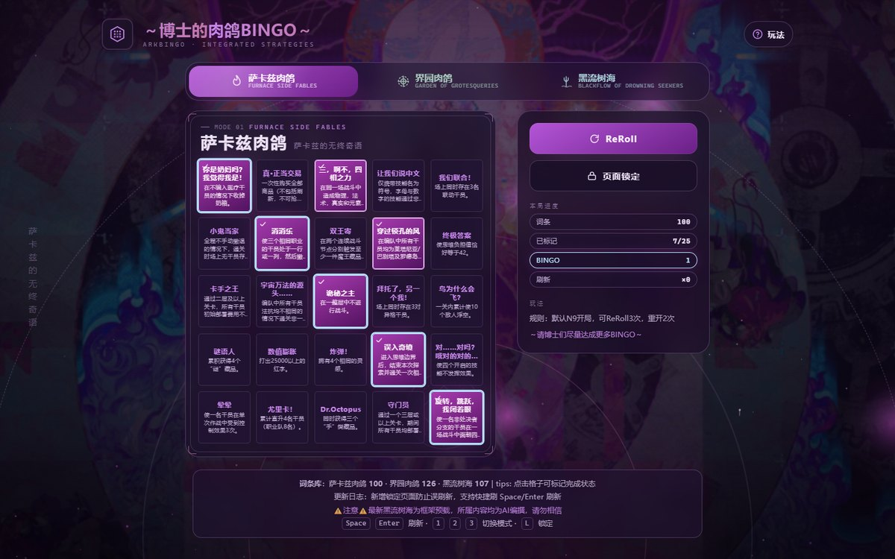
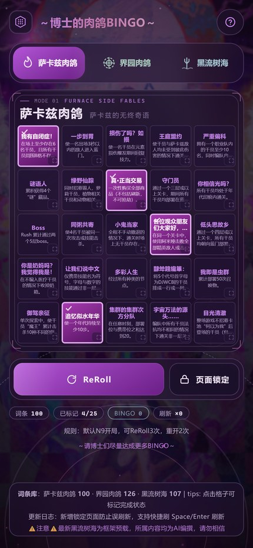
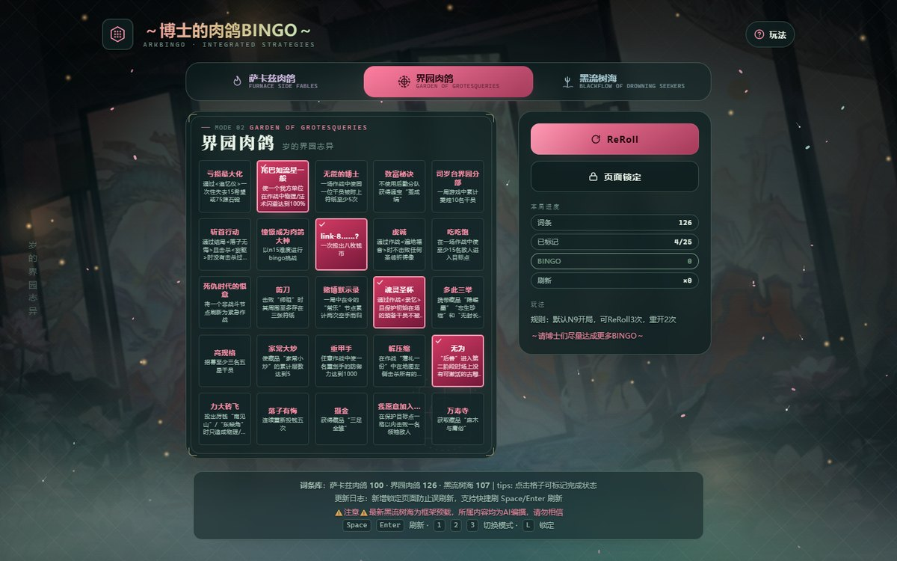
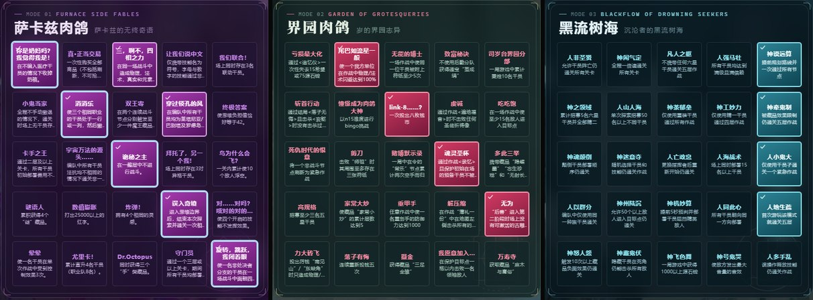

<div align="center">

<!-- ===== 动态变色标题 ===== -->
<a href="https://gott1stt0t.github.io/ArkBingo/">
  
</a>

<br>

<!-- ===== 徽章墙 ===== -->
<p>
  
  
  
  
  
  
</p>

> ⚠️ **警告**：黑流树海模式为框架预载，所属内容均为 AI 编撰，请勿相信！仅供娱乐！

</div>

---

## ⚡ 项目简介

这是一款基于《明日方舟》集成战略（肉鸽）玩法的同人 BINGO 小游戏合集。

默认 **N9 开局**，可 **ReRoll 3 次**，重开 **2 次**。  
目标只有一个：

> **让博士们尽量达成更多 BINGO！**

整个项目仍然是 **零构建、零后端、零安装**，打开即玩。  
幻彩切换、雷霆刷新、神秘词条、点击标记——博士，你的肉鸽命运，就在这 5×5 的方寸之间！

<div align="center">
  
  <br>
  <sub>萨卡兹肉鸽 · 紫色主题（连成 BINGO 的格子会亮起描边）</sub>
</div>

---

## 🆕 本次重做

### 1. 手机端全面适配

<p align="center">
  
</p>

- **自适应棋盘**：5×5 棋盘始终完整落在屏幕内，不再横向滚动、不再被裁切。
- **触屏交互**：格子点按即标记；右下角小按钮可展开**完整词条**（底部抽屉），长描述不再只能看半截。
- **安全区域**：适配刘海屏 / 灵动岛 / 底部指示条（`env(safe-area-inset-*)`），`100dvh` 避免地址栏跳动。
- **横屏可用**：横屏手机自动收起次要信息，棋盘依旧完整。
- **按钮够大**：所有可点区域 ≥ 48px，符合触屏习惯；关闭系统点击高亮闪烁。

### 2. 三种模式，三套切换动画 + 专属粒子

切换模式时会播放一段只属于该模式的过场，**每个模式内部还有各自的常驻动画与粒子**：

| 模式 | 主色调 | 切换动画 | 常驻粒子 |
|------|--------|----------|----------|
| **萨卡兹肉鸽** | 紫罗兰 / 品红 | 紫色火光横扫、碎片迸裂、屏幕震动 | 上升的紫色余烬、飘落的灰烬、偶发火花、缓慢游走的魂火 |
| **界园肉鸽** | 夜色 / 青玉 / 胭脂 | 水墨自中心晕开、朱砂印章、落花飘散 | 旋转落下的花瓣、浮动的暖色花粉、柔软薄雾、飘散的种子 |
| **黑流树海** | 墨蓝 / 青冰 | 黑潮自下涌起、涟漪扩散、扫描线 | 上浮的气泡、悬浮的浮游光点、下沉的暗尘、随流漂移的碎片 |

发牌（ReRoll / 切换模式）时也会按模式播放不同的入场动画：萨卡兹是翻牌灼烧、界园是墨点晕开、黑流树海是自深处浮起。

> 动画节奏参考了鹰角官方活动页：[熔炉还魂记](https://ak.hypergryph.com/is/furnacesidefables)、[岁的界园志异](https://ak.hypergryph.com/is/gardenofgrotesqueries)、[沉沦者的黑流树海](https://ak.hypergryph.com/is/blackflowofdrowningseekers)。

### 3. 每个模式一张主视觉背景

三个模式分别使用一张主视觉作为全屏背景，切换时交叉淡入，并带有极缓慢的推近（Ken Burns）与对应色调的压暗层，保证棋盘可读：

| 模式 | 背景 |
|------|------|
| 萨卡兹 | `assets/bg-sarkaz.jpg` |
| 界园 | `assets/bg-garden.jpg` |
| 黑流树海 | `assets/bg-blackflow.jpg` |

萨卡兹的紫色主色调（`#b455d8` / `#c887ec` / `#a83bb0` 等）直接取自第一张主视觉的紫罗兰与品红。

界园是深色的夜园：主视觉被压暗成月色，底部再叠一层缓慢流动的**极光**——三层光帘（薄荷 / 青蓝 / 胭脂）加一层竖向光丝，配合呼吸般的明暗起伏。

<div align="center">
  
</div>

### 4. 其它

- 右上角 **玩法 / 快捷键** 面板（手机上也看得到规则）；
- **BINGO 连线自动判定**：连线格子描边高亮，右上角计数；
- 进度自动保存在本地，关掉页面再回来棋盘和标记都还在。

---

## 三个肉鸽

| 模式 | 词条数 | 状态 |
|------|--------|------|
| 萨卡兹肉鸽 | 100 | ✅ 已实装 |
| 界园肉鸽 | 126 | ✅ 已实装 |
| 黑流树海 | 107 | ⚠️ 框架预载 / AI 编撰 |

> 黑流树海模式的内容均为 AI 编撰，请勿当作官方设定或真实攻略。  
> 词条内容与上游仓库逐条比对，**未做任何增删改动**。

<div align="center">
  
  <br>
  <sub>左起：萨卡兹肉鸽 / 界园肉鸽 / 黑流树海</sub>
</div>

---

## 🎲 玩法规则

1. 选择一个集成战略：**萨卡兹 / 界园 / 黑流树海**。
2. 随机抽取 **25 个不重复词条**，生成 5×5 BINGO 网格。
3. 点击任意格子，即可标记为“已完成”。
4. 再次点击，取消标记。
5. 尽量让标记连成一条线——横、竖、斜，都算 BINGO！连成后会高亮并在右上角计数。
6. 不满意？点击 **ReRoll**，或按 **Space / Enter** 直接刷新。
7. 怕误刷新？点击 **页面锁定**，把当前命运钉死在泰拉大地上。
8. 格子里的字看不全？点格子右下角的小按钮，展开完整词条。

进度会自动保存在本地，关掉页面再回来，棋盘和标记都还在。

---

## ⌨️ 快捷键

| 操作 | 功能 |
|------|------|
| `Space` / `Enter` | 未锁定时刷新 BINGO |
| `R` | 刷新 BINGO |
| `1` / `2` / `3` | 切换萨卡兹 / 界园 / 黑流树海 |
| `←` / `→` | 在模式按钮间切换 |
| `L` | 页面锁定 / 解锁 |
| `Esc` | 关闭弹窗 |
| 鼠标点击格子 | 标记 / 取消完成状态 |
| 点击 `ReRoll` | 重新随机抽取 25 个词条 |
| 点击 `页面锁定` | 锁定 / 解锁页面，防止误刷新 |

---

## 🧩 词条格式

可以投稿
词条遵循以下格式：

```js
"标题 描述内容"
```

例如：

```js
"我有自闭症！ 在场上至少存在6名干员，且所有干员周围8格不存在我方单位的情况下通过3关。"
```

标题与描述之间用**第一个空格**分隔；没有空格时整条作为标题显示。

---

## 📁 文件结构

```text
ArkBingo/
├── index.html           页面结构（背景层 / 棋盘 / 控制台 / 过场遮罩）
├── css/
│   └── style.css        全部样式：3 套配色、3 张主视觉层、过场动画、响应式
├── js/
│   ├── data.js          词条库（与上游逐条一致，未改动）
│   └── app.js           抽词、棋盘、BINGO 判定、模式切换、粒子系统
├── assets/
│   ├── bg-sarkaz.jpg      萨卡兹主视觉背景
│   ├── bg-garden.jpg      界园主视觉背景
│   ├── bg-blackflow.jpg   黑流树海主视觉背景
│   ├── title.svg          README 动态标题
│   ├── favicon.svg        站点图标
│   ├── preview.jpg        桌面端预览图
│   ├── preview-garden.jpg 界园夜园预览图
│   ├── preview-mobile.jpg 手机端预览图
│   └── modes.jpg          三模式预览图
└── Readme.md
```

没有 npm，没有 webpack，没有 vite，没有复杂的依赖树。  
只有 HTML、CSS、JS，以及博士的肉鸽之魂。直接双击 `index.html` 就能玩。

---

## 🛠️ 技术栈

| 技术 | 用途 |
|------|------|
| HTML5 | 页面结构、内联 SVG 图标与纹样 |
| 原生 CSS | 主题变量、容器查询、`clip-path` 过场、玻璃拟态、动画 |
| Canvas 2D | 每个模式四类粒子的氛围系统（余烬 / 花瓣 / 气泡 / 碎片…） |
| 原生 JavaScript | 词条抽取、网格生成、模式切换、BINGO 判定、锁定、快捷键 |
| Web Storage | 记住当前模式、棋盘与标记 |
| GitHub Pages | 在线部署 |

不依赖任何 CDN —— 断网也能打开（图标、纹样、字体栈全部本地化）。

---

## 🚀 本地运行

克隆仓库：

```bash
git clone https://github.com/Gott1stT0T/ArkBingo.github.io.git
cd ArkBingo.github.io
```

直接双击 `index.html` 即可。

或者下载右方最新 release。

> 想用本地服务器也行：`python -m http.server` 后访问 `http://localhost:8000`。

---

## 🌐 在线部署

本项目已经适配 GitHub Pages，推送到 `main` 分支即可。

---

## 🆘 注意事项

- 当前 `ReRoll` 按钮在代码层面没有硬性次数限制，规则文本写的是“可 ReRoll 3 次”，只做次数统计不做拦截。
- 黑流树海模式为框架预载，词条均由 AI 编撰，请勿相信。
- 游戏内标题使用了 `background-clip: text`，在部分老旧浏览器上可能显示为纯色，请使用现代浏览器。
- 棋盘字号使用了容器查询单位（`cqw`），极老的浏览器会回退到 `vw` 方案，排版略有差异。
- 开启了「减少动态效果」（`prefers-reduced-motion`）时，会自动关闭过场动画与粒子，只保留内容变化。
- 三张主视觉仅作同人作品背景使用，版权归原作者 / 鹰角网络所有。
- 本项目为非官方同人作品，与鹰角网络无关。

---

## 🗺️ 未来计划

- [x] 自动检测 BINGO 连线并播放庆祝动画
- [x] 移动端体验优化
- [x] 每个肉鸽一套专属背景与粒子
- [x] 界园底部极光
- [ ] 增加 ReRoll 次数限制与显示
- [ ] 更多肉鸽主题
- [ ] 让博士们连成更多线

---

## 🤝 贡献

欢迎所有博士来添砖加瓦！

1. Fork 本仓库。
2. 新建分支。
3. 添加新词条、新功能或修复问题。
4. 提交 Pull Request。

或者再 issue 内提交建议

词条格式请保持：

```js
"标题 描述"
```

请勿提交侵权素材、违规内容或冒充官方的设定。

---

## ⚠️ 免责声明

> 本项目为非官方同人作品，与鹰角网络无关。  
> 《明日方舟》及其相关名称、设定、角色版权归鹰角网络所有。  
> 黑流树海模式为框架预载，所有词条均由 AI 编撰，请勿相信。  
> 本项目仅供娱乐、交流与学习使用，禁止用于商业冒充官方。

---

## 📜 协议 / License

代码部分采用 **MIT License**。  
你可以自由使用、修改、分发、商用，只需保留版权声明。

### ⚡ 神秘雷霆超级幻彩闪光超绝补充协议 v1.3

1. 明日方舟是鹰角的，罗德岛是博士的，Bingo 是大家的。
2. 你可以 Fork、Clone、魔改、二创，拿去和群友开黑。
3. 你可以把词条换成自己群里的黑话，但别拿去卖钱还说是官方。
4. 黑流树海暂时是 AI 编的，信了就会被雷劈。
5. 让背景安静，让文字闪耀。
6. 玩得开心，BINGO 拉满，别让博士在肉鸽里孤独。
7. 黑流树海太好玩了，所以让我们先想想词条写啥

---

## 鸣谢

感谢**嘲月**与**御坂16382**对词条库的编写

---

<div align="center">

**⚡ 让 BINGO 在罗德岛疯狂连成线！⚡**

<sub>By Dr. 嘲月, Gott1stT0T, 御坂16382</sub>

</div>
